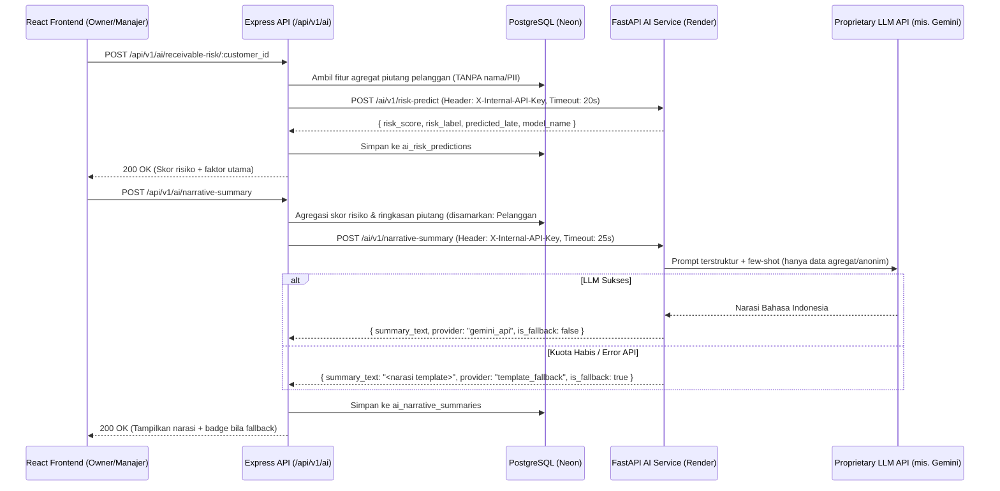

# Deliverable T02-D02 — Kontrak REST API `/api/v1` & Integrasi FastAPI/Streamlit (v1.0)

> **Status Dokumen:** Draf **v1.0** disusun oleh **Dwi Yoanda Febriarsa (PIC T02 & Integrasi)** pada **21 November 2026**. Seluruh *field*, tipe data, dan aturan validasi selaras dengan [schema.sql](../database/schema.sql) (**T02-D03 v1.1**).  
> **Spesifikasi OpenAPI 3.0.3 (Siap Import Postman/Swagger):** [openapi-v1.yaml](./openapi-v1.yaml).  
> Seluruh contoh payload di bawah menggunakan **data sintetis** (tidak memuat data riil Maltajaya).

---

## 1. Standar Global API Express (`/api/v1`)

### Base URL & Autentikasi
- **Base Path:** `/api/v1`
- **Content-Type:** `application/json`
- **Autentikasi:** `Authorization: Bearer <jwt_access_token>` pada semua endpoint kecuali `GET /health` dan `POST /auth/login`.
- **Role yang Berlaku:** `inventory` | `produksi` | `qc` | `owner_manager`
- **Aturan *Field-Stripping* Privasi:** Untuk role `produksi` dan `qc`, backend **wajib menghapus field `selling_price` dan `piecework_rate`** dari seluruh respons `/products` sebelum dikirim ke client (bukan sekadar disembunyikan di frontend).

### Format Response Envelope Standar
**Sukses (`200 OK`, `201 Created`):**
```json
{
  "success": true,
  "message": "Data berhasil dimuat",
  "data": {},
  "meta": {
    "page": 1,
    "limit": 20,
    "total": 120,
    "total_pages": 6
  }
}
```

**Error (`400`, `401`, `403`, `404`, `409`, `422`, `503`):**
```json
{
  "success": false,
  "error": {
    "code": "INSUFFICIENT_STOCK",
    "message": "Stok tidak mencukupi untuk produk SYN-MTT-30B (tersedia: 3, diminta: 5).",
    "details": [
      {
        "field": "items[0].qty",
        "sku_code": "SYN-MTT-30B",
        "available_stock": 3,
        "requested_qty": 5
      }
    ]
  }
}
```

### Kode Error Bisnis Baku (Untuk Notifikasi UI yang Jelas)
| HTTP | `error.code` | Kondisi Pemicu |
| :---: | :--- | :--- |
| `400` | `VALIDATION_ERROR` | Payload gagal validasi Joi (field kosong, tipe salah, angka negatif). |
| `401` | `UNAUTHORIZED` | Token JWT hilang, tidak valid, atau kedaluwarsa. |
| `403` | `FORBIDDEN` | Role pengguna tidak berwenang mengakses endpoint/aksi ini. |
| `404` | `NOT_FOUND` | Resource (`id` / `sku_code`) tidak ditemukan. |
| `409` | `DUPLICATE_SKU` / `DUPLICATE_CODE` | `sku_code`, `customer_code`, atau `username` sudah terdaftar. |
| `422` | `PRICE_UNVERIFIED` | Produk memiliki `selling_price = null`; konfirmasi nota ditolak. |
| `422` | `STOCK_UNINITIALIZED` | Produk memiliki `stock_initialized_at = null` ("Belum ada saldo awal"); konfirmasi nota ditolak. |
| `422` | `INSUFFICIENT_STOCK` | Jumlah pesanan melebihi `current_stock`. |
| `409` | `INVALID_STATUS_TRANSITION` | Nota sudah `confirmed`/`void` atau QC sudah menambah stok (`stock_added_at != null`). |
| `503` | `AI_SERVICE_UNAVAILABLE` | Layanan FastAPI *timeout* / *cold start* / tidak terjangkau (frontend tampilkan pesan ramah, pencatatan utama tetap normal). |

---

## 2. Daftar Endpoint Inti Express (`/api/v1`)

### A. System, Auth & Users (`T03` — PIC: Dwi)
| Method | Endpoint | Role | Keterangan |
| :---: | :--- | :--- | :--- |
| `GET` | `/health` | Publik | Cek status server & koneksi PostgreSQL (digunakan *keep-alive* sebelum demo). |
| `POST` | `/auth/login` | Publik | Login dengan `{ username, password }` → kembalikan `{ access_token, user }`. |
| `GET` | `/auth/me` | Semua | Ambil profil & role user yang sedang login. |
| `POST` | `/auth/change-password` | Semua | Ubah kata sandi akun sendiri (validasi password lama). |
| `GET` | `/users` | `owner_manager` | Daftar seluruh akun pengguna. |
| `POST` | `/users` | `owner_manager` | Buat akun pengguna baru (`bcrypt` hash, opsional link `employee_id`). |
| `PATCH` | `/users/:id` | `owner_manager` | Ubah role, nama, atau status `is_active` pengguna. |

---

### B. Produk & Mutasi Stok (`T05` — PIC: Dwi)
| Method | Endpoint | Role | Keterangan |
| :---: | :--- | :--- | :--- |
| `GET` | `/products` | Semua | Daftar produk berpaginasi. Query: `?search=&main_category=&sub_category=&stock_status=uninitialized|empty|available&page=1&limit=25`. *(`produksi`/`qc` tanpa `selling_price`).* |
| `GET` | `/products/lookup/:sku_code` | Semua | **Instant lookup untuk Auto-Fill Nota A4.** Backend menormalisasi `UPPER(TRIM(sku_code))` sebelum query. |
| `GET` | `/products/:id` | Semua | Detail 1 produk + 10 mutasi terakhir. |
| `POST` | `/products` | `inventory`, `owner_manager` | Tambah produk baru. Joi menormalisasi `sku_code` (`UPPER/TRIM`). `selling_price` boleh `null` jika belum terverifikasi. |
| `PATCH` | `/products/:id` | `inventory`, `owner_manager` | Ubah data produk. *(Hanya `owner_manager` yang boleh mengubah `selling_price` & `piecework_rate`.)* |
| `POST` | `/products/:id/initialize-stock` | `inventory`, `owner_manager` | **Verifikasi saldo awal fisik** (berlaku termasuk jika `initial_qty = 0`). Mengisi `stock_initialized_at = NOW()` dan mencatat `stock_movements ('initial_stock')` bila `qty > 0`. |
| `POST` | `/products/:id/adjust-stock` | `inventory`, `owner_manager` | Koreksi stok manual (`adjustment_in` / `adjustment_out`) dengan `reason` wajib diisi (mis. barang rusak/retur/selisih opname). Ditolak jika stok belum diinisialisasi atau hasil < 0. |
| `GET` | `/stock-movements` | `qc`, `inventory`, `owner_manager` | Riwayat mutasi stok berpaginasi. Query: `?product_id=&movement_type=&date_from=&date_to=&page=1&limit=25`. |

**Contoh `POST /api/v1/products/:id/initialize-stock`:**
```json
{
  "initial_qty": 12,
  "reason": "Hasil cek fisik saldo awal rak patung [SINTETIS]"
}
```

---

### C. Nota Penjualan A4 (`T06` — PIC: Dwi)
| Method | Endpoint | Role | Keterangan |
| :---: | :--- | :--- | :--- |
| `GET` | `/invoices` | `inventory`, `owner_manager` | Daftar nota berpaginasi. Query: `?customer_id=&payment_type=&status=&date_from=&date_to=&search=`. |
| `GET` | `/invoices/:id` | `inventory`, `owner_manager` | Detail lengkap nota beserta `customer`, `items` (nilai *snapshot*), `print_count`, dan metadata untuk render cetak A4. |
| `POST` | `/invoices` | `inventory`, `owner_manager` | Buat nota baru (`status`: `draft` atau langsung `confirmed`). Jika `confirmed`, langsung menjalankan transaksi atomik potong stok + buat entri piutang/kas. |
| `POST` | `/invoices/:id/confirm` | `inventory`, `owner_manager` | Konfirmasi nota dari `draft` → `confirmed` (potong stok atomik + kunci *snapshot* harga). |
| `POST` | `/invoices/:id/print` | `inventory`, `owner_manager` | Mencatat aksi cetak A4 (`print_count += 1`). **Idempoten: tidak pernah memotong stok lagi.** |
| `POST` | `/invoices/:id/void` | `owner_manager` | Membatalkan nota `confirmed` (`void_reason` wajib). Mengembalikan stok (`invoice_void_in`) dan mencatat penyesuaian di piutang/kas. |

**Contoh Request `POST /api/v1/invoices`:**
```json
{
  "invoice_date": "2026-11-21",
  "customer_id": "3fa85f64-5717-4562-b3fc-2c963f66afa6",
  "payment_type": "tempo",
  "shipping_cost": 150000,
  "shipping_courier": "EKSPEDISI CONTOH",
  "status": "confirmed",
  "notes": "Pengiriman tahap 1 [SINTETIS]",
  "items": [
    { "product_id": "9b1deb4d-3b7d-4bad-9bdd-2b0d7b3dcb6d", "qty": 4 },
    { "product_id": "1b9d6bcd-bbfd-4b2d-9b5d-ab8dfbbd4bed", "qty": 2 }
  ]
}
```
> **Validasi Server-Side Wajib saat `status = "confirmed"`:**
> 1. Kunci baris `products` dengan `FOR UPDATE`.
> 2. Tolak dengan `422 PRICE_UNVERIFIED` jika ada item dengan `selling_price IS NULL`.
> 3. Tolak dengan `422 STOCK_UNINITIALIZED` jika ada item dengan `stock_initialized_at IS NULL`.
> 4. Tolak dengan `422 INSUFFICIENT_STOCK` jika `qty > current_stock` (kembalikan daftar item yang kurang agar UI bisa menampilkan peringatan spesifik).
> 5. Hitung `subtotal`, `total_amount`, dan `due_date` (`invoice_date + customer.default_term_days` bila `tempo`) sepenuhnya di server.

---

### D. Pelanggan & Buku Besar Piutang (`T08` — PIC: Dwi)
| Method | Endpoint | Role | Keterangan |
| :---: | :--- | :--- | :--- |
| `GET` | `/customers` | `inventory`, `owner_manager` | Daftar pelanggan + saldo piutang berjalan (dari `v_customer_receivable_balances`). Query: `?search=&customer_type=&has_balance=true`. |
| `POST` | `/customers` | `inventory`, `owner_manager` | Tambah pelanggan baru (`customer_code` unik, mis. `TK-SYN-001`). |
| `PATCH` | `/customers/:id` | `inventory`, `owner_manager` | Ubah profil/termin tempo pelanggan. |
| `GET` | `/customers/:id/receivables` | `inventory`, `owner_manager` | **Kartu Piutang (Ledger)** per pelanggan: daftar urut `tanggal | uraian | debit | kredit | running_balance` + ringkasan saldo & umur piutang. |
| `POST` | `/receivables/payments` | `inventory`, `owner_manager` | Catat pembayaran piutang (baris `credit`, mendukung cicilan/pembayaran gabungan tanpa mengikat 1 nota) + opsional otomatis masuk `cash_transactions ('pelunasan_piutang')`. |
| `POST` | `/receivables/entries` | `owner_manager` | Tambah entri piutang manual (`ongkir` susulan atau `penyesuaian`). |

**Contoh Request `POST /api/v1/receivables/payments`:**
```json
{
  "customer_id": "3fa85f64-5717-4562-b3fc-2c963f66afa6",
  "entry_date": "2026-11-21",
  "amount": 1500000,
  "payment_method": "transfer_bca",
  "description": "Transfer BCA cicilan piutang [SINTETIS]",
  "record_to_cash": true
}
```

---

### E. Produksi/QC, Payroll & Kas (`T07`, `T09`, `T10` — Koordinasi Arif & Khairunnisa)
| Method | Endpoint | Role | Keterangan |
| :---: | :--- | :--- | :--- |
| `GET` / `POST` | `/production-qc` | `produksi`, `qc`, `inventory`, `owner_manager` | Daftar & input hasil produksi (`POST` oleh `produksi`/`owner_manager`, status awal `pending`). |
| `PATCH` | `/production-qc/:id/inspect` | `qc`, `owner_manager` | Input hasil inspeksi QC (`passed_qty`, `rework_qty`, `rejected_qty`). Jika `passed_qty > 0` dan `stock_added_at IS NULL`, otomatis menambah `products.current_stock` + catat `stock_movements ('qc_in')`. |
| `GET` / `POST` / `PATCH` | `/employees` | `owner_manager` | Master karyawan harian, borongan, dan Prodo (`T09`). |
| `GET` / `POST` | `/attendances` | `owner_manager` | Input/rekap absensi harian (`M`, `L`, `T` menit, `P` premi). |
| `GET` / `POST` | `/payrolls` | `owner_manager` | Buat periode gaji 2 mingguan & hitung otomatis slip harian + borongan (menggunakan rumus `Sheet 2` + parameter `craft_bonus_rate` & `prodo_pool_total`). |
| `GET` | `/payrolls/:id` | `owner_manager` | Detail seluruh slip gaji dalam periode tersebut. |
| `PATCH` | `/payrolls/:id/finalize` | `owner_manager` | Kunci periode gaji (`paid`) + opsional catat pengeluaran agregat ke `cash_transactions ('gaji_payroll')`. |
| `GET` / `POST` | `/cash-transactions` | `owner_manager` | Buku kas bulanan (pemasukan/pengeluaran) & filter `?month=YYYY-MM&direction=&category=`. |
| `GET` | `/cash-transactions/summary` | `owner_manager` | Ringkasan pemasukan, pengeluaran, dan saldo bulanan (dari `v_monthly_cash_summary`). |

---

## 3. Kontrak Integrasi Backend Express ↔ FastAPI AI Service (`T13` & `T14` — Naufal, Robbi, Dwi)



> **Aturan Privasi Integrasi AI (Sesuai Project Plan `[S1]`):**
> - Frontend **TIDAK PERNAH** memanggil FastAPI atau API proprietary secara langsung; seluruh panggilan lewat backend Express.
> - Express **wajib menyamarkan identitas pelanggan** menjadi token anonim (`"CUST-ANON-01"`) sebelum mengirim konteks ke FastAPI/LLM, sehingga nama toko asli, alamat, dan nomor telepon tidak pernah keluar ke API pihak ketiga.
> - Pengiriman data riil agregat ke API proprietary tetap menunggu persetujuan PIC (selama belum ada izin, gunakan data sintetis dengan `is_synthetic_data: true`).

### Endpoint di Express (Dipanggil Frontend — Role: `owner_manager`)
| Method | Endpoint Express | Keterangan |
| :---: | :--- | :--- |
| `POST` | `/api/v1/ai/receivable-risk/:customer_id` | Hitung skor risiko keterlambatan 1 pelanggan lewat FastAPI dan simpan ke `ai_risk_predictions`. |
| `GET` | `/api/v1/ai/receivable-risk/history` | Ambil riwayat prediksi risiko tersimpan (`?customer_id=&limit=20`). |
| `POST` | `/api/v1/ai/narrative-summary` | Minta ringkasan naratif generatif atas daftar risiko piutang & simpan ke `ai_narrative_summaries`. |
| `GET` | `/api/v1/ai/narrative-summary/history` | Ambil riwayat ringkasan naratif tersimpan (mencegah pemanggilan ulang API saat demo). |

### Kontrak Endpoint FastAPI (Dibangun Naufal & Robbi — `T13`)
Keamanan antar-layanan: Header `X-Internal-API-Key: <SHARED_SECRET>` (disimpan di environment variable Render).

**1. `GET /ai/v1/health`**
```json
{
  "status": "ok",
  "model_loaded": true,
  "active_model": "random_forest_v1"
}
```

**2. `POST /ai/v1/risk-predict`** *(Draf fitur — untuk dikonfirmasi Naufal & Robbi setelah `T12`)*
- **Request (dari Express):**
```json
{
  "customer_ref": "CUST-ANON-01",
  "is_synthetic_data": true,
  "features": {
    "default_term_days": 60,
    "current_balance": 2470000,
    "total_debit_6m": 11200000,
    "total_credit_6m": 8730000,
    "payment_ratio": 0.7795,
    "avg_days_to_pay": 66.0,
    "open_bon_count": 2,
    "days_since_last_payment": 15
  }
}
```
- **Response (`200 OK`):**
```json
{
  "customer_ref": "CUST-ANON-01",
  "model_name": "random_forest_v1",
  "model_version": "1.0.0",
  "risk_score": 0.7420,
  "risk_label": "tinggi",
  "predicted_late": true,
  "top_factors": [
    "Rata-rata lama pelunasan (66 hari) melebihi termin 60 hari",
    "Terdapat 2 tagihan bon terbuka dengan sisa saldo tinggi"
  ]
}
```

**3. `POST /ai/v1/narrative-summary`**
- **Request (dari Express — agregat/disamarkan):**
```json
{
  "summary_scope": "overall_receivables",
  "period_label": "November 2026",
  "is_synthetic_data": true,
  "metrics": {
    "total_outstanding_receivables": 48500000,
    "total_customers_with_balance": 18,
    "high_risk_count": 4,
    "medium_risk_count": 6,
    "low_risk_count": 8
  },
  "top_risk_items": [
    { "customer_ref": "Mitra-A", "balance": 6500000, "risk_score": 0.82, "risk_label": "tinggi" },
    { "customer_ref": "Mitra-B", "balance": 4200000, "risk_score": 0.74, "risk_label": "tinggi" }
  ]
}
```
- **Response (`200 OK`):**
```json
{
  "provider": "gemini_api",
  "is_fallback": false,
  "summary_text": "Ringkasan [Data Sintetis]: Total piutang berjalan sebesar Rp48.500.000 pada 18 mitra. Terdapat 4 mitra berisiko keterlambatan tinggi yang disarankan menjadi prioritas penagihan, dipimpin Mitra-A dan Mitra-B. Hasil ini bersifat pendukung dan tidak menggantikan verifikasi pencatatan utama."
}
```

---

## 4. Kontrak Integrasi Dasbor Data Science / Streamlit (`T11` & `T14` — Ezra & Dwi)

1. **Mode Integrasi di Aplikasi Web (`T14`):**
   - Halaman `/dashboard` di React menampilkan **Kartu Ringkasan KPI Native** yang mengambil data langsung dari endpoint Express `GET /api/v1/analytics/overview` (cepat, tidak terkena *sleep* Streamlit), **didampingi tab/panel embed `<iframe>`** ke URL Streamlit Community Cloud (`VITE_STREAMLIT_DASHBOARD_URL`) untuk eksplorasi visual interaktif, filter lanjutan, dan unggah file Excel.
   - Jika `<iframe>` Streamlit sedang *sleeping* / gagal dimuat, tombol *"Buka Dasbor di Tab Baru"* dan KPI Native di Express tetap berfungsi penuh.
2. **Sumber Data Streamlit (Opsi Sinkronisasi untuk Ezra):**
   - **Opsi A (Direkomendasikan — via Read-Only API Express):** Streamlit memanggil endpoint Express dengan header `X-Internal-API-Key` agar tidak perlu memegang kredensial langsung ke DB produksi:
     - `GET /api/v1/analytics/overview`
     - `GET /api/v1/analytics/receivables` (isi `v_customer_receivable_balances`)
     - `GET /api/v1/analytics/sales-stock` (isi `v_product_sales_summary`)
     - `GET /api/v1/analytics/cashflow` (isi `v_monthly_cash_summary`)
   - **Opsi B (Alternatif via Unggahan CSV/Excel atau Koneksi Read-Only Postgres):** Jika Ezra ingin menyambungkan Streamlit langsung ke 3 SQL Views di Neon (`v_customer_receivable_balances`, `v_monthly_cash_summary`, `v_product_sales_summary`) menggunakan user database *read-only*, struktur view pada [schema.sql](../database/schema.sql) sudah siap pakai.

---

## 5. Poin Konfirmasi Singkat untuk Tim (Async Review `T02-D02`)

- **Untuk Naufal & Robbi (`T12`, `T13`):** Apakah 8 fitur pada `POST /ai/v1/risk-predict` sudah cocok sebagai kontrak awal, atau ada nama fitur yang ingin disesuaikan setelah *wrangling*?
- **Untuk Ezra (`T11`):** Lebih nyaman mengambil data dasbor Streamlit dari 4 endpoint `/api/v1/analytics/*` (Opsi A) atau koneksi langsung ke 3 SQL Views di PostgreSQL (Opsi B)?
- **Untuk Arif (`T07`, `T09`, `T10`):** Apakah daftar endpoint `/production-qc`, `/employees`, `/attendances`, `/payrolls`, dan `/cash-transactions` sudah mencukupi seluruh aksi UI yang direncanakan?
