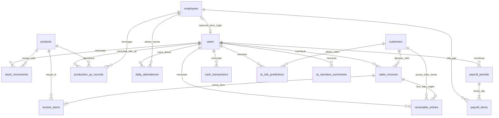

# Deliverable T02-D03 — Skema Basis Data PostgreSQL & Matriks Hak Akses (v1.1)

> **Status Dokumen:** Draf **v1.1** (label diselaraskan dengan Project Tracker: **`D03` = Skema Basis Data**) disusun oleh **Dwi Yoanda Febriarsa (PIC T02 & Integrasi)** pada **21 November 2026** berdasarkan Project Plan `[S1]`, hasil wawancara `[S2]`, struktur data operasional dari Kenan `[S5]`, dan revisi review DDL produk & view penjualan.  
> **File SQL Siap Eksekusi:** [schema.sql](../database/schema.sql) (PostgreSQL 15+ / Neon Free Tier, tanpa data riil).

---

## 1. Diagram Relasi Entitas (ERD Lengkap — 15 Tabel)

---

## 2. Ringkasan 15 Tabel & 3 View Analitik

### Domain 1 — Kepegawaian & Autentikasi (`T03`, `T09`)
| Tabel | Fungsi Utama | Keputusan Desain Kunci |
| :--- | :--- | :--- |
| `employees` | Master seluruh pekerja harian, borongan, & tim Prodo (~70+ orang). | Dipisah dari `users` karena mayoritas pekerja borongan tidak butuh akun login. Memiliki `employee_code` unik dan `alias_name` untuk mengatasi inkonsistensi nama di Excel (`LATIF` vs `LATIF RIFQI`, `FAJER` vs `FAJAR`). |
| `users` | Akun login aplikasi dengan 4 role baseline Project Plan. | `role IN ('inventory', 'produksi', 'qc', 'owner_manager')`, password disimpan sebagai hash `bcrypt`, opsional terhubung ke `employee_id`. |

### Domain 2 — Pelanggan, Katalog Produk & Mutasi Stok (`T05` — PIC: Dwi)
| Tabel | Fungsi Utama | Keputusan Desain Kunci |
| :--- | :--- | :--- |
| `customers` | Master mitra toko, gereja, dan perorangan (~200–300+ entitas). | `customer_code` unik (mis. `285`) untuk cetak di pojok kanan atas Nota A4; `default_term_days` default `60` hari. |
| `products` | Katalog Patung, Salib, Tempat Lilin, Perlengkapan (~2.700+ SKU). | *Primary key* memakai `UUID`. **`sku_code`** ditegakkan baku di DB dengan `UNIQUE` + `CHECK (sku_code = UPPER(BTRIM(sku_code)) AND sku_code <> '')` serta dinormalisasi di API (baris katalog yang bentrok **tidak digabung otomatis** sebelum Maltajaya memastikan identitas barang). **`selling_price`** memakai `BIGINT` dan **boleh `NULL`** bila harga belum terverifikasi. **`current_stock`** (`DEFAULT 0`, `CHECK >= 0`) didampingi **`stock_initialized_at TIMESTAMPTZ` (nullable)** agar UI membedakan `"Belum ada saldo awal"` (`NULL`) vs stok nol terverifikasi (`NOT NULL`). |
| `stock_movements` | Log *append-only* setiap perubahan stok masuk/keluar/koreksi. | Menyimpan `stock_before`, `stock_after`, `qty_change`, `movement_type`, `reference_type/id`, `reason`, dan `created_by` untuk keterlacakan penuh. |

### Domain 3 — Nota Penjualan A4 & Buku Besar Piutang (`T06`, `T08` — PIC: Dwi)
| Tabel | Fungsi Utama | Keputusan Desain Kunci |
| :--- | :--- | :--- |
| `sales_invoices` | Header Nota Penjualan A4 (tunai/tempo). | `invoice_number` unik otomatis (menangani kasus 2 nota di hari sama untuk 1 pelanggan). Menyimpan `shipping_cost`, `shipping_courier`, `stock_deducted_at` (idempotensi agar cetak ulang tidak memotong stok 2x), serta kolom `void` jika nota dibatalkan. |
| `invoice_items` | Baris barang dalam Nota A4. | Menyimpan **`sku_snapshot`**, **`product_name_snapshot`**, dan **`unit_price_snapshot`** karena terbukti dari `Sheet 3` harga berubah antar tahun. |
| `receivable_entries` | Buku besar (*ledger*) piutang per pelanggan sesuai Gambar 5. | Mendukung debit (`bon`, `ongkir`) dan kredit (`pembayaran` parsial/gabungan tanpa harus mengikat 1 nota), lengkap dengan `due_date` dan `payment_method` (`tunai`, `transfer_bca`, dll.). |

### Domain 4 — Produksi/QC, Absensi, Payroll & Kas (`T07`, `T09`, `T10` — Arif)
| Tabel | Fungsi Utama | Keputusan Desain Kunci |
| :--- | :--- | :--- |
| `production_qc_records` | Catatan hasil produksi dan inspeksi QC. | Hanya `passed_qty` saat `qc_status = 'passed'` yang memicu `stock_movements ('qc_in')`. Dilengkapi `stock_added_at` agar tidak menambah stok 2x. |
| `daily_attendances` | Absensi karyawan harian (M, L, T, P dari `Sheet 2`). | Mencatat `work_day_credit` (`NUMERIC` agar mendukung `1.5`), `overtime_hours`, `late_minutes`, dan `craft_bonus_eligible`. |
| `payroll_periods` & `payroll_items` | Rekap gaji 2 mingguan (harian + borongan + alokasi Prodo). | Parameter `craft_bonus_rate` (default Rp10.000) dan `prodo_pool_total` dapat diubah per periode sesuai rencana mitigasi risiko Project Plan. |
| `cash_transactions` | Pencatatan pemasukan (`in`) & pengeluaran (`out`) kas bulanan. | Mendukung kategori kas nyata dari Gambar 1 (`tambah_modal`, `gaji_payroll`, `kasbon_karyawan`, `cicilan_kasbon`, `operasional`, `paket_cod`, dll.). |

### Domain 5 — Modul AI Pendukung (`T13`, `T14` — Naufal, Robbi, Dwi)
| Tabel | Fungsi Utama | Keputusan Desain Kunci |
| :--- | :--- | :--- |
| `ai_risk_predictions` | Riwayat skor risiko keterlambatan piutang dari FastAPI. | Menyimpan `model_name`, `input_features_json` (JSONB), `risk_score`, `risk_label`, dan flag `is_synthetic_data`. |
| `ai_narrative_summaries` | Riwayat narasi generatif Bahasa Indonesia. | Menyimpan `prompt_context_json` (hanya agregat/disamarkan tanpa nama toko riil), `summary_text`, dan flag `is_fallback` jika API proprietary terkena batas kuota. |

### 3 SQL Views Siap Pakai (Backend Express & Dasbor Streamlit Ezra)
1. **`v_customer_receivable_balances`** — Menghitung otomatis `total_debit`, `total_credit`, dan `current_balance` per pelanggan.
2. **`v_monthly_cash_summary`** — Rekap pemasukan, pengeluaran, dan saldo bersih kas per bulan (`YYYY-MM`).
3. **`v_product_sales_summary`** — Rekap qty terjual dan omzet per produk dengan menggabungkan **hanya detail `invoice_items` yang berpasangan dengan `sales_invoices.status = 'confirmed'`** (melalui subquery `INNER JOIN` sebelum `LEFT JOIN` ke `products`), sehingga nota `draft` dan `void` tidak pernah ikut terjumlah; turut menyertakan `stock_initialized_at`.

---

## 3. Aturan Integritas Transaksi (Wajib Diterapkan di Backend Express)

1. **Simpan/Konfirmasi Nota (`POST /api/v1/invoices`):** Dieksekusi dalam **1 transaksi PostgreSQL (`BEGIN ... COMMIT`)** dengan row lock `SELECT current_stock, selling_price, stock_initialized_at FROM products WHERE id = ... FOR UPDATE`:
   - **Tolak konfirmasi nota** apabila ada produk dengan `selling_price IS NULL` (harga belum terverifikasi) atau `stock_initialized_at IS NULL` (belum ada saldo awal).
   - Cek stok tiap item; jika `qty > current_stock`, kembalikan peringatan/error agar stok tidak pernah negatif.
   - Insert `sales_invoices` & `invoice_items` (dengan *snapshot* kode, nama, dan harga).
   - Kurangi `products.current_stock`, insert `stock_movements ('invoice_out')`, dan isi `sales_invoices.stock_deducted_at = NOW()`.
   - Jika `payment_type = 'tempo'`, otomatis insert baris `receivable_entries ('bon')` (dan baris `'ongkir'` jika `shipping_cost > 0`).
   - Jika `payment_type = 'tunai'`, otomatis insert baris `cash_transactions ('in', 'penjualan_tunai')`.
2. **Inisialisasi Saldo Awal Stok (`POST /api/v1/products/:id/initialize-stock`):** Memverifikasi saldo fisik pertama kali (termasuk bila jumlahnya `0`), mencatat `stock_movements ('initial_stock')` jika `qty > 0`, dan mengisi `products.stock_initialized_at = NOW()`. Selama `stock_initialized_at IS NULL`, UI menampilkan status **"Belum ada saldo awal"**.
3. **Normalisasi & Anti-Merge SKU:** API menormalisasi `sku_code` (`UPPER` + `TRIM`) sebelum `INSERT/UPDATE` agar sesuai constraint DB. Saat impor katalog dari Excel nanti, baris dengan kode bentrok atau kosong **tidak digabung otomatis** dan harus ditandai untuk konfirmasi Maltajaya terlebih dahulu.
4. **Cetak Ulang Nota:** Hanya menaikkan `sales_invoices.print_count` — **tidak pernah** menyentuh stok maupun ledger piutang.
5. **Pembatalan Nota (`POST /api/v1/invoices/:id/void`):** Mengubah status menjadi `void`, mengembalikan stok via `stock_movements ('invoice_void_in')`, dan membuat baris `penyesuaian` pada piutang/kas jika relevan.
6. **Lolos QC (`PATCH /api/v1/production-qc/:id/inspect`):** Hanya jika `stock_added_at IS NULL` dan `passed_qty > 0`, tambahkan `products.current_stock`, catat `stock_movements ('qc_in')`, dan set `stock_added_at = NOW()`.

---

## 4. Matriks Hak Akses 4 Peran (Usulan Baseline RBAC untuk Validasi PIC)

| Modul / Fitur | `produksi` | `qc` | `inventory` | `owner_manager` |
| :--- | :---: | :---: | :---: | :---: |
| **Data Patung/Salib — Kode, Nama, Stok** | Lihat | Lihat | Lihat, Tambah, Ubah | Penuh |
| **Data Patung/Salib — Harga Jual** | ❌ Disembunyikan | ❌ Disembunyikan | Lihat *(ubah hanya Owner/Manajer)* | Penuh |
| **Riwayat Mutasi & Koreksi Stok** | ❌ | Lihat | Lihat, Koreksi Manual | Penuh |
| **Nota Penjualan A4 & Cetak** | ❌ | ❌ | Lihat, Buat, Cetak *(Void: Owner)* | Penuh (termasuk Void) |
| **Produksi (Input Hasil)** | Lihat, Tambah | Lihat | Lihat | Penuh |
| **QC (Inspeksi Lolos/Rework → Tambah Stok)** | Lihat status | Lihat, Inspeksi/ACC | Lihat | Penuh |
| **Pelanggan & Piutang per Toko** | ❌ | ❌ | Lihat, Catat Bayar *(opsional)* | Penuh |
| **Payroll (Harian & Borongan)** | ❌ | ❌ | ❌ | Penuh |
| **Kas Bulanan** | ❌ | ❌ | ❌ | Penuh |
| **Dasbor DS, Skor Risiko & Ringkasan Gen AI** | ❌ | ❌ | ❌ | Penuh |
| **Manajemen Akun Pengguna (`users`)** | ❌ | ❌ | ❌ | Penuh |
| **Halaman Panduan Penggunaan** | Sesuai peran | Sesuai peran | Sesuai peran | Penuh |

---

## 5. Poin Review Singkat untuk Rekan Tim (Async Check)

- **Untuk Ezra (`T04`, `T11`):** Cek nama kolom pada `products`, `sales_invoices`, `receivable_entries`, `cash_transactions`, serta 3 `VIEW` di bagian akhir [schema.sql](../database/schema.sql) apakah sudah nyaman untuk query Streamlit dan *export* dataset ML.
- **Untuk Arif (`T07`, `T09`, `T10`):** Cek apakah tabel `production_qc_records`, `daily_attendances`, `payroll_periods`, `payroll_items`, dan `cash_transactions` sudah mencakup seluruh input UI yang dibutuhkan (termasuk potongan telat & alokasi Prodo).
- **Untuk Naufal & Robbi (`T12`, `T13`):** Cek struktur `ai_risk_predictions` dan `ai_narrative_summaries` (khususnya kolom `input_features_json`, `risk_score`, `risk_label`, dan `is_fallback`).
